# RF Nation: AI Customer Support & Operations Platform

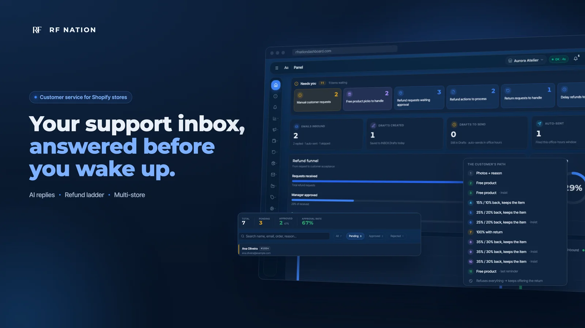

**Live platform:** https://rfnationdashboard.com/

## The problem

Online stores answer the same customer emails every day: where is my order, returns, refunds, delays, wrong addresses. It's slow, repetitive work, and a mistake involving money is expensive.

## What it does

RF Nation is an autonomous AI email agent with a multi-client dashboard, built for Shopify stores. It reads customer messages, checks real order data and drafts replies in the customer's language. Anything with financial impact needs human approval.

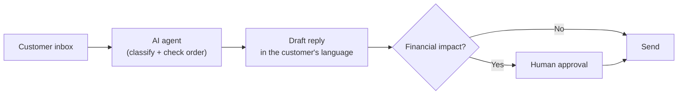

## Features

- **Autonomous email agent:** intent classification with OpenAI models, customer photo analysis, real order data, and replies in the customer's language.
- **20+ flows modelled as state machines:** refunds, returns, delays, wrong addresses.
- **Human approval for anything financial,** enforced at permission level.
- **Multi-client dashboard:** ~40 pages on an API with ~200 endpoints, with AI cost and token telemetry and agent health monitoring.
- **Continuous quality testing** of the agent's output on real cases.
- **More tools:** an AI-generated product catalogue from images, a maintenance copilot with planning mode and an audit log, TOTP 2FA and role-based access.

## Screenshots

All screenshots use a demo store with made-up customers, orders and figures.

### Dashboard

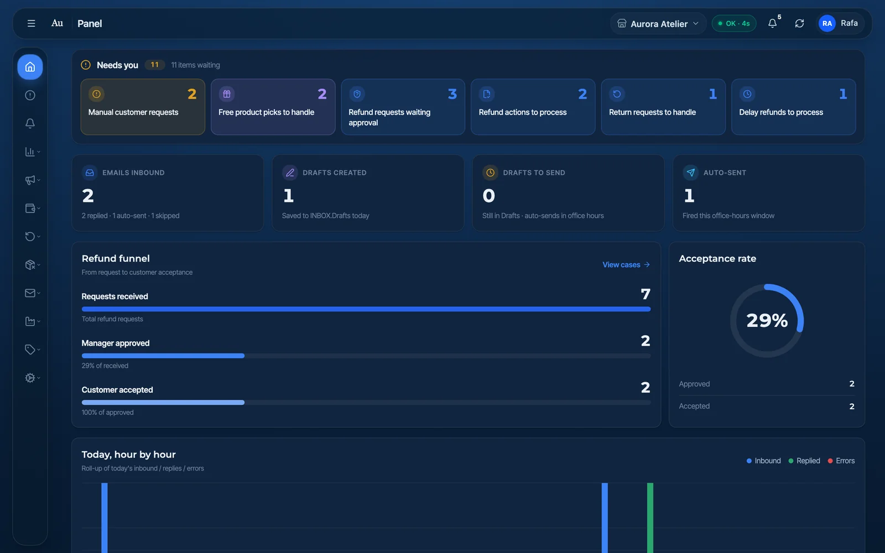
*The overview: what needs a human today, what the agent drafted and sent, and how refund requests are converting.*

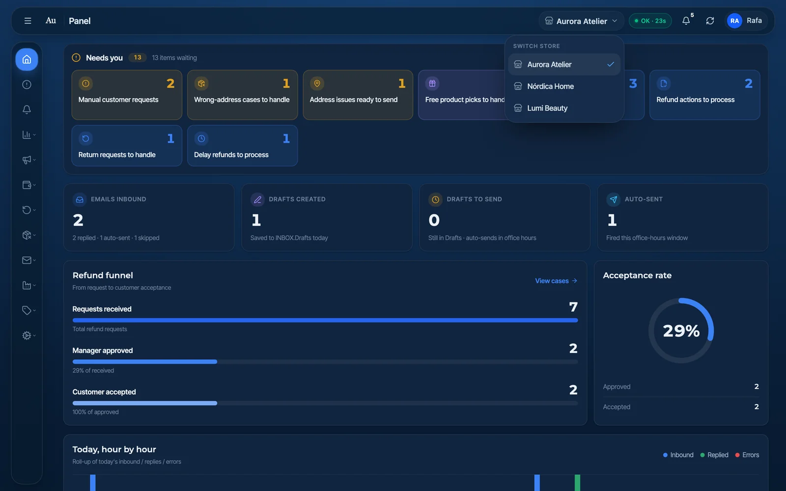
*One dashboard for many clients: switch stores from the header.*

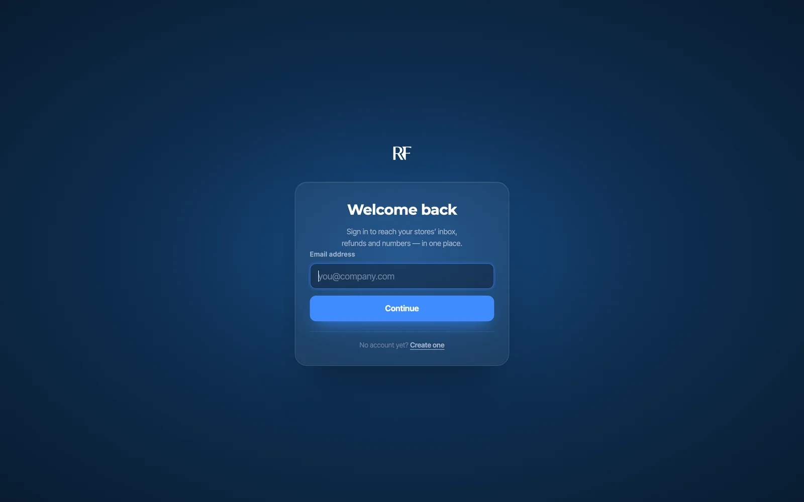
*Account sign-in, protected by TOTP two-factor authentication.*

### Email agent

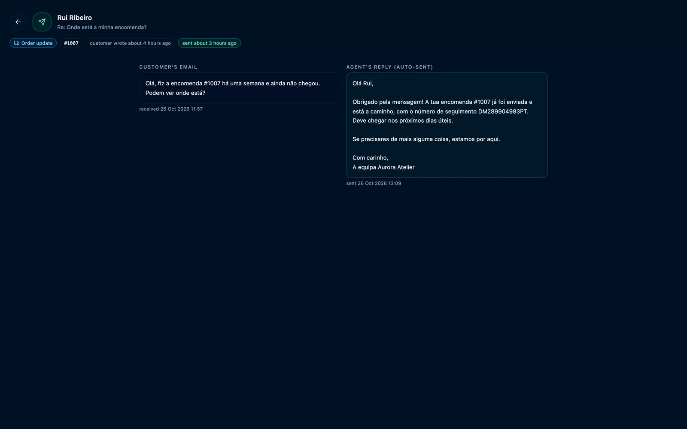
*A customer email next to the reply the agent sent, written in the customer's language with the real order status.*

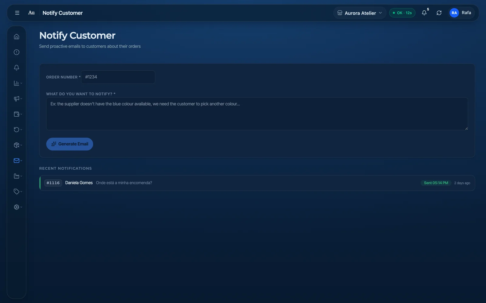
*Proactive emails: describe the situation in a sentence and the agent writes the message to the customer.*

### Refunds & approvals

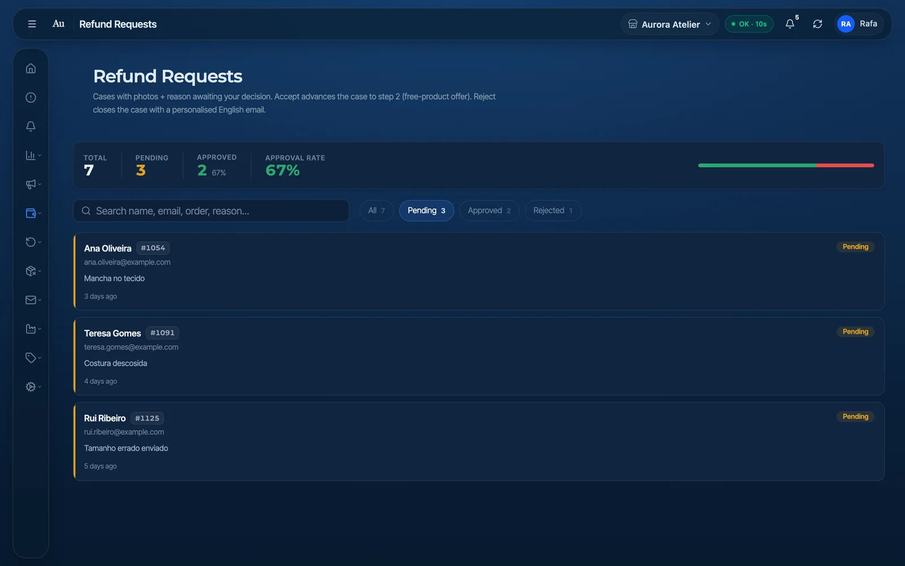
*Refund requests arrive with photos and a reason. A manager approves or rejects each one before anything moves.*

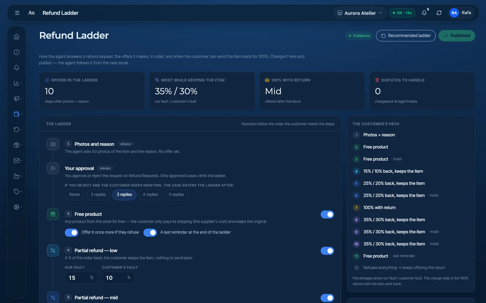
*An editable refund ladder: the offers the agent can make, in order. Change it, publish, and the agent follows it from the next email.*

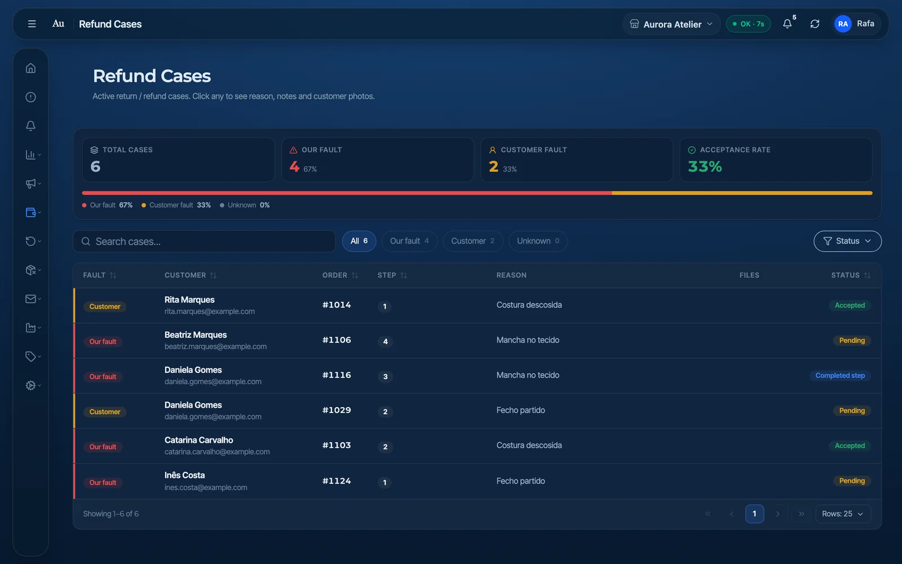
*Every open case, with fault, step and status, in one table.*

### Delivery issues

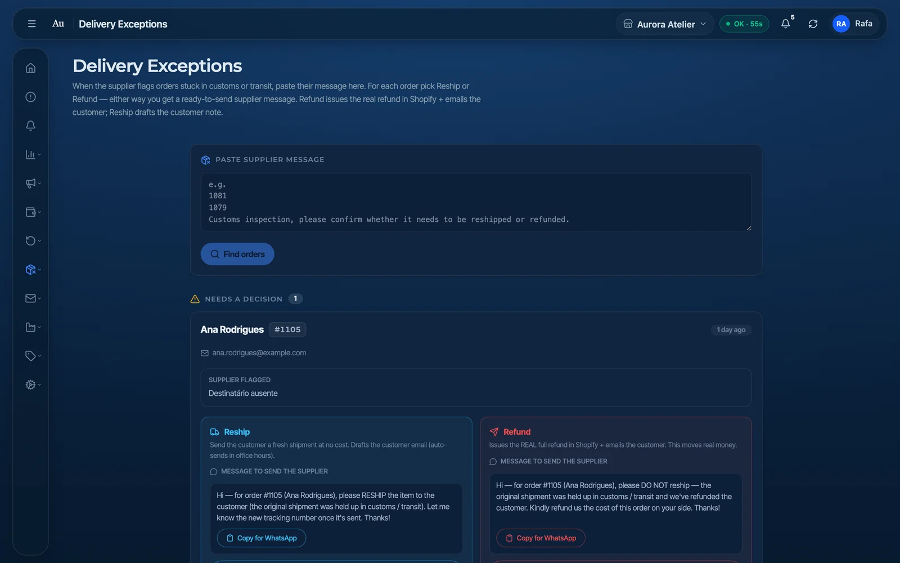
*Orders stuck in customs or transit: pick reship or refund, and get a ready-to-send message for the supplier.*

### Insights & costs

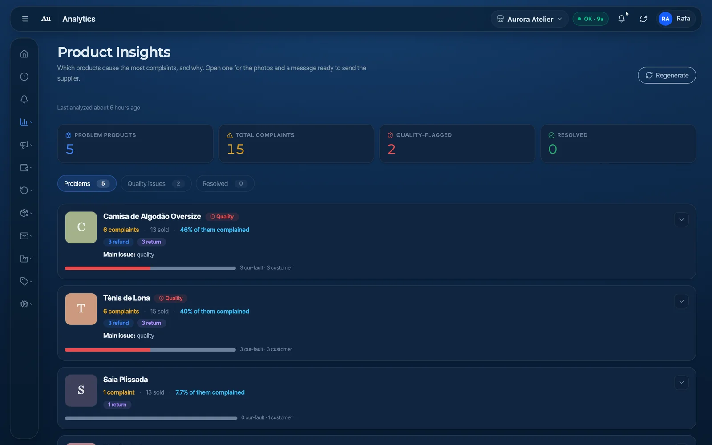
*Which products cause the most complaints, and why.*

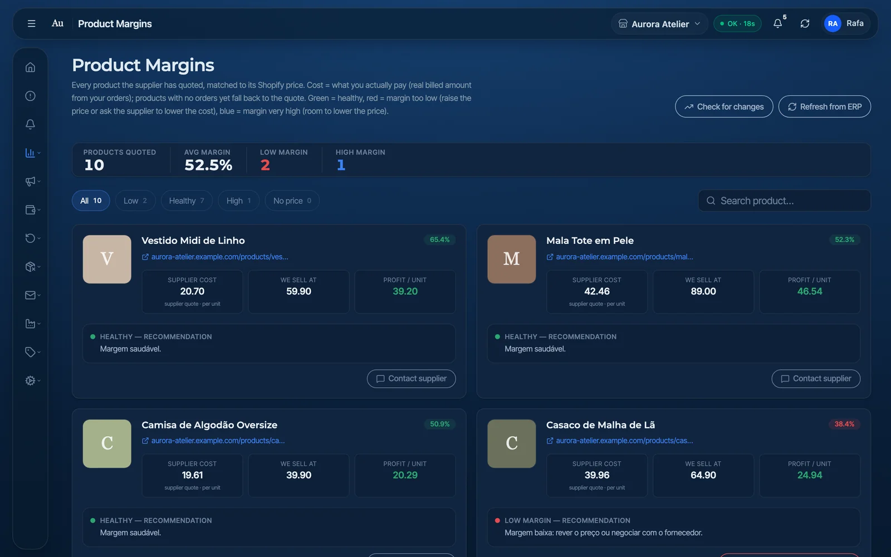
*Supplier cost against selling price for every product, with a recommendation for each.*

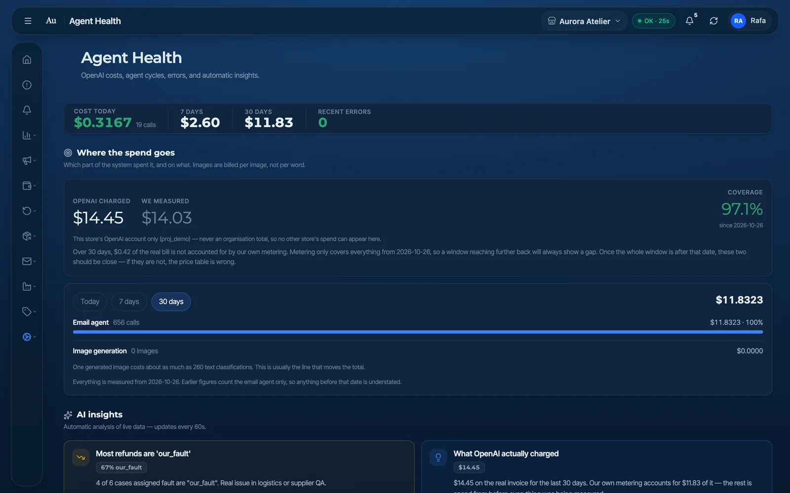
*AI spend, agent activity and errors at a glance, checked against what the AI provider actually billed.*

## Stack

Python · FastAPI · SQLite · React 19 · TypeScript · Tailwind · OpenAI API · Claude Agent SDK · Shopify API

Deployed on a Linux VPS (systemd).

## Results

- In production.
- 10+ clients served to date.
- 20+ AI agent flows in production.
- The platform keeps evolving with client feedback.

## Role

**Creator & Developer**, Jul 2026 – present.

---

Full source is private (production system with real clients). Live demo available on request.

© 2026 Rafael Soares Duarte. All rights reserved.

Portfolio: https://rafaelduarte-portfolio.com
